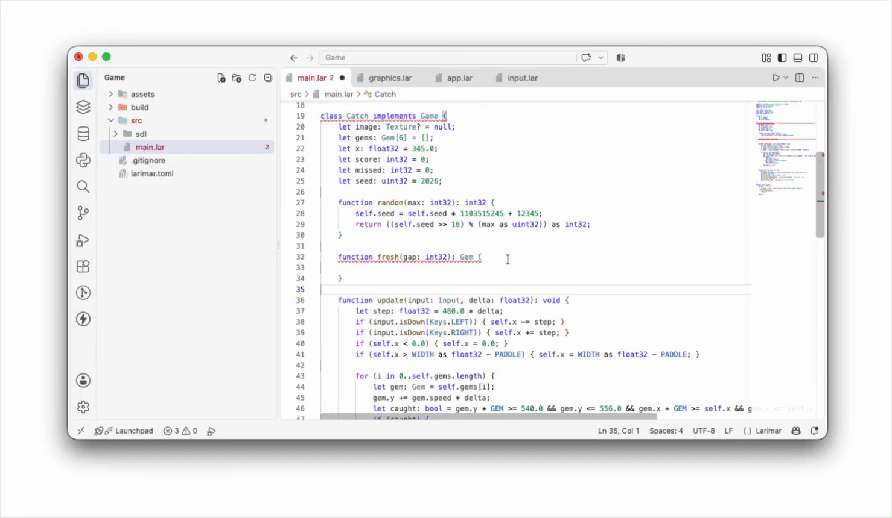
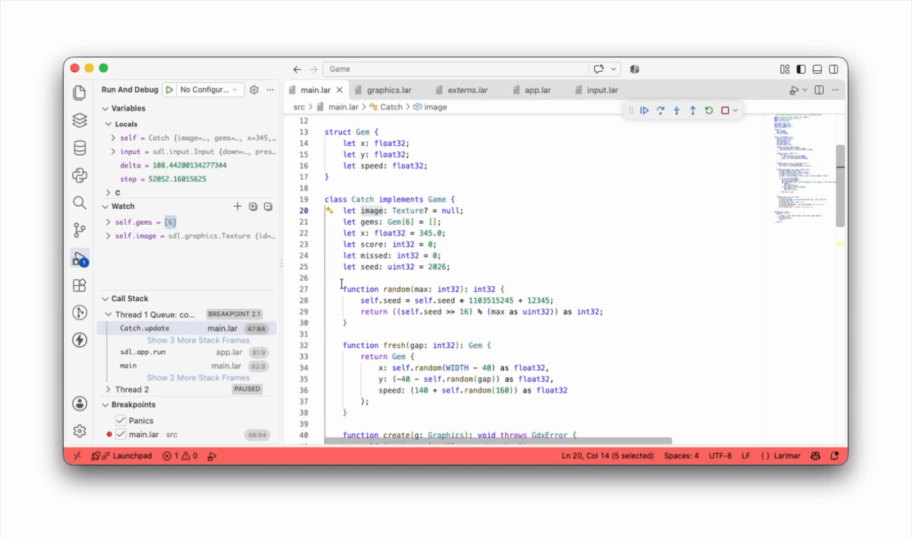
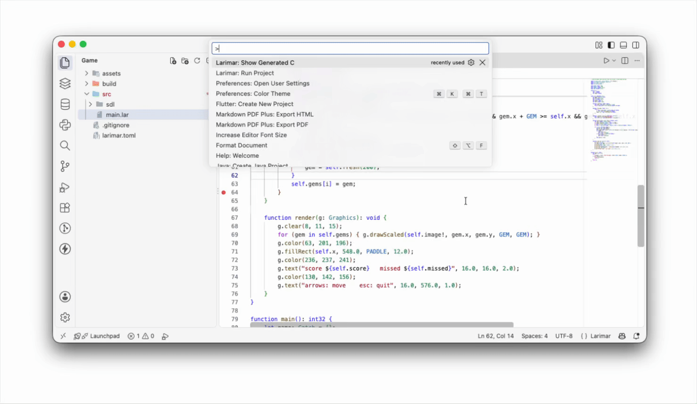

  

  

    
    <!-- 
     -->
    
  

---

# Larimar Tools for Visual Studio Code
This Visual Studio Code extension provides support for Larimar programming language

---
# Setup
1. Open the Settings: **File > Preferences > Settings**
   (**Code > Settings... > Settings** on macOS), or press <kbd>Ctrl</kbd> + <kbd>,</kbd> / <kbd>Cmd</kbd> + <kbd>,</kbd>.
2. Type `Larimar: Home` in the search box at the top.
3. Write the path to Larimar's installation folder (the one with `bin/larimarc`
   and `std/`) in the **Larimar: Home** field, for example `/Users/you/larimar`.
   It saves automatically.

---

# Features

## Writing Larimar in VSCode

  

The extension starts the Larimar language server (larimar lsp) in the background, so the editor understands your code while you write it:

Syntax highlighting for all of Larimar, including #when, wait until and released by.
Errors as you type. The same messages as the compiler, underlined in place, across every file of the project, also for unsaved changes.
Hover over a name to see its type, its signature and the comment written above its declaration.
Go to Definition of functions, types, fields and variables, even in other modules or in the standard library.
Find All References to a name across the project.
Outline of each file: its types, functions and members.
Completion of names, module members, and the fields and methods of a value after the ..
Signature help while you write a call: the parameters and which one comes next.

## Debugging Larimar in VS Code

  

Run Larimar: Debug Project (or press F5) to build your program with debug information and start it under the debugger. You work with your Larimar code, not the generated C:

 1. Breakpoints in .lar files. Click next to a line, or stop at a function by its Larimar name (main, Order.total).
 2. Step through your code line by line: step over, step into, step out, continue.
 3. A call stack with Larimar names, without the internal names of the generated C.
 4. Your variables as you wrote them. Strings, numbers, optionals, lists, Any tables, objects (showing the fields of their real class) and enums, with expandable children. The compiler’s temporary variables are hidden.
 5. Expressions in Watch and hover, such as order.customer, items[2], points[1].y or names.length.
 6. Panics as exceptions. When the program stops on a runtime error (an index out of range, ! on null, a division by zero), the debugger stops right there and shows the message and the line.

## Commands

  

  1. **Larimar: Run Project** Builds the project and runs it.
  2. **Larimar: Build Project** Only builds the executable in build/.
  3. **Larimar: Debug Project** builds with --debug and starts the debugger (larimar dap over lldb-dap), with breakpoints in your .lar files.
  4. **Larimar: Check Project** Looks for errors without generating C or compiling; it’s fast.
  5. **Larimar: Restart Language Server** restarts larimar lsp (live errors, hover, completion). Use it if the editor stops responding or after updating the compiler.

---

# License
MIT License, See [LICENSE](LICENSE) for more information.